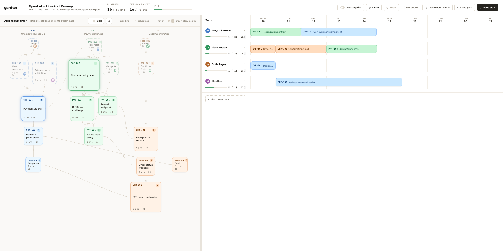
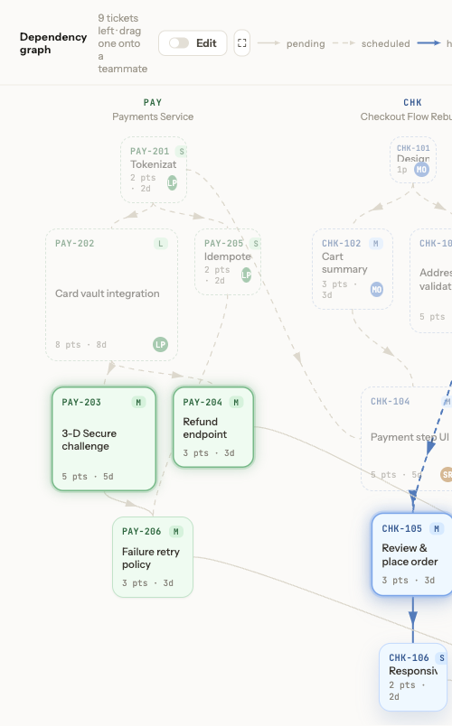
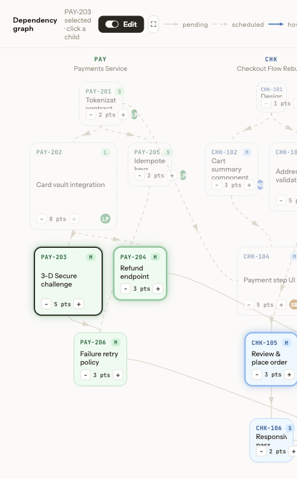
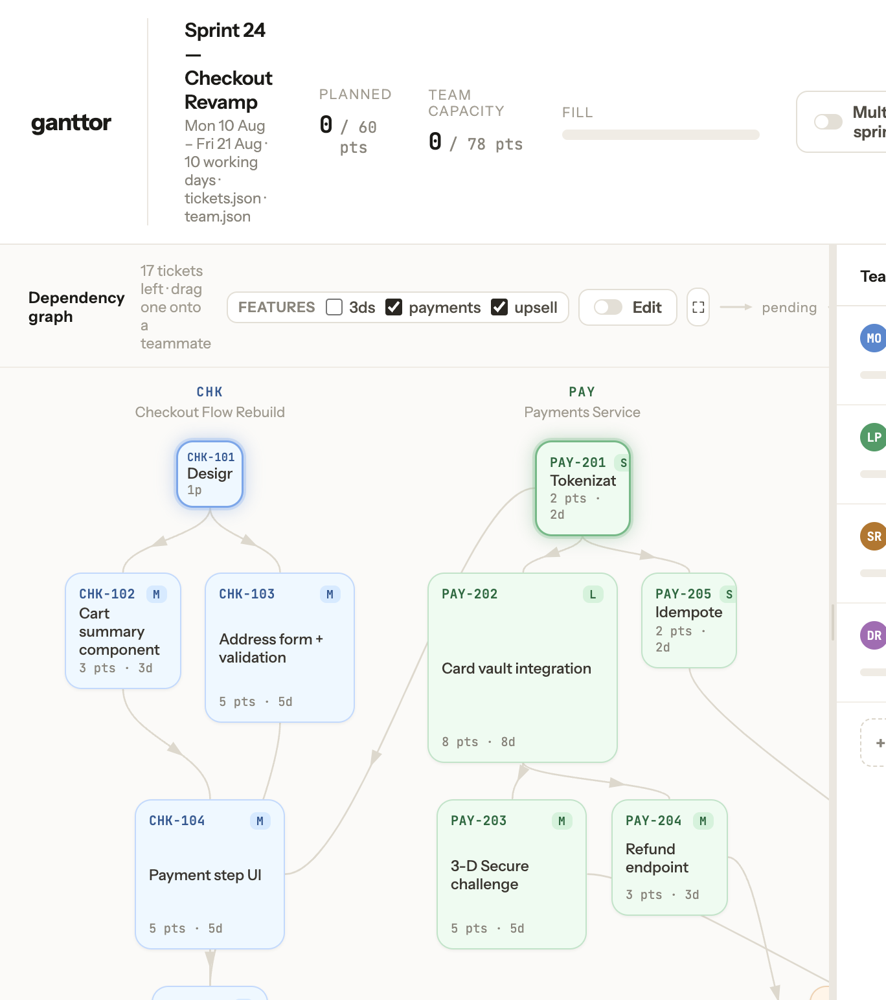
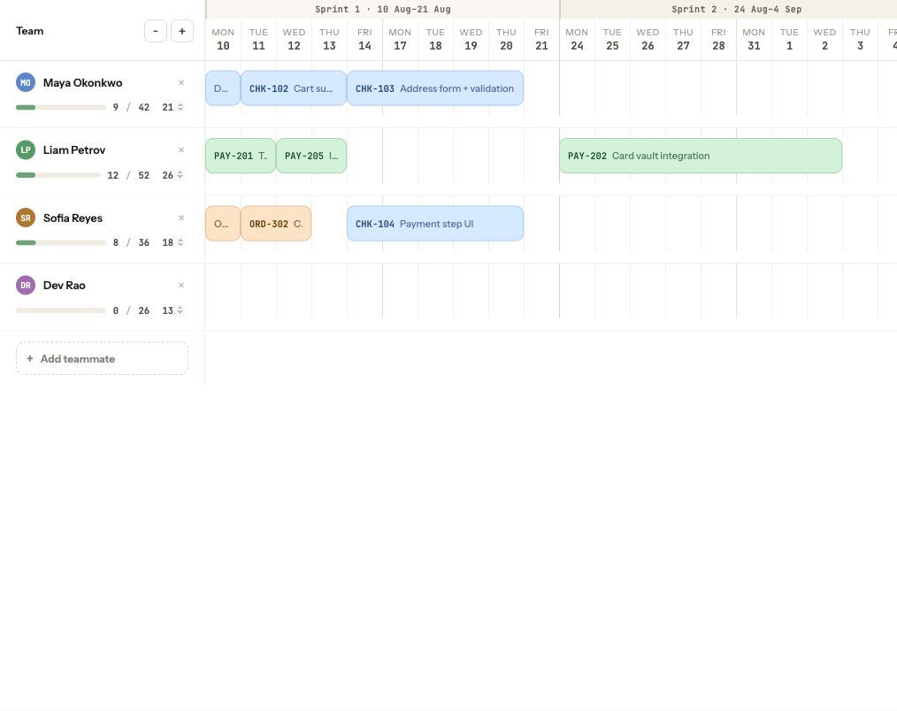

# ganttor

Most sprint planning tools miss the link between dependencies and capacity — that is why **ganttor** exists.

Local sprint planner: drag tickets from a dependency graph onto teammates and watch capacity fill on a Gantt board.



## See it

**Ready tickets** glow when their dependencies are already scheduled:



**Edit mode** — step story points (−/+) and two-click to add a dependency:



**Feature flags** — turn a slice off; those tickets leave the map and deps bridge across the gap:



**Gantt + capacity** — bars across working days, utilization per teammate:



## What you get

- **Dependency graph** — tickets by epic, arrows for parent → child, pending vs scheduled deps  
- **Ready-ticket highlight** — unblocked work glows so you know what can go next  
- **Feature flags** — optional `features` on tickets; toggle slices off the map/Gantt (deps bridge across gaps)  
- **Role limits** — optional `roles` on tickets; only teammates sharing a role can take them (unconstrained = anyone)  
- **Drag-and-drop assign** — drop onto a teammate; start day respects capacity, gaps, deps, and roles  
- **Block day ranges** — optional per-person calendar `blocks` in `team.json`; gray on the Gantt, work can straddle (like weekends), effective capacity shrinks for those days  
- **Auto-plan** — one click schedules every remaining ticket onto the team (roles, capacity, deps respected); keeps teammates on one epic unless switching finishes significantly earlier or load skew is high  
- **Graph Edit** — step story points, add/remove deps (cycles blocked); plan refreshes after each change  
- **Gantt + capacity** — per-person bars, utilization, planned vs team capacity  
- **Multi-sprint, undo/redo, save/load** — plan beyond one sprint, ⌘Z history, download `sprint-plan.json` / `tickets.json`

## Try it

Serve the project over HTTP (the app loads JSON via `fetch`). First load needs the network for Google Fonts and the Design Component runtime.

```bash
npm start
# or: python3 -m http.server 8000
```

Open [http://localhost:8000/](http://localhost:8000/).

1. Sample checkout backlog ships in `data/tickets.json` and `data/team.json` — reload to fetch.  
2. Drag a glowing (ready) ticket onto a teammate; click a Gantt bar to unassign.
3. Click **Auto-plan** to schedule everything still unassigned; tune `gain ≥` (days) and `skew >` (%) in the header to control how strongly teammates stay on one epic. One ⌘Z undoes the whole run.  
4. Use **Features** checkboxes to hide a slice (e.g. turn off `3ds`); deps bridge across hidden tickets.  
5. Turn on **Edit** to change estimates or dependencies.  
6. Toggle **Multi-sprint** when work won’t fit in one sprint.  
7. **Save plan** / **Download tickets** to keep the schedule and backlog edits (exports use the active feature projection).

## Data files

| File | Role |
|------|------|
| `data/tickets.json` | Sprint meta (optional `sprint.autoPlan`: `switchGainDays`, `maxSkewPct`), epics, sizes, tickets (`id`, `epic`, `title`, `pts`, `deps`, optional `features`, optional `roles`) |
| `data/team.json` | Role catalog (`roles` ids) + people (`id`, `name`, `roles`, `capacity`, optional `blocks: [{ start, end }]` ISO dates) |
| `sprint-plan.json` | Optional saved schedule (`gantt`, `capacityPlan`, totals, optional `featureFlags`) |

Reload reads from disk. **Download tickets** / **Save plan** trigger browser downloads — drop them into the project root (plan) or `data/` (tickets) when you want edits to stick. If the JSON files cannot be read, the app falls back to built-in sample data.

**Downloaded files do not replace the originals.** Download only creates a new file in your browser's download folder. The app never overwrites `data/tickets.json` or `sprint-plan.json`; copying a downloaded file over the original (or keeping both) is left to you.

### Save / load (short)

- Tickets with no `roles` (or `[]`) can go to anyone; otherwise the teammate must share **at least one** role id. Mismatch hard-blocks assign (same as over-capacity). Edit roles in JSON; the Gantt shows person roles and ticket tooltips show required roles.  
- Optional person `blocks` (`start`/`end` ISO dates, same day = one day) gray that row on the Gantt; work may straddle; effective capacity is `floor(cap × availableWorkingDays / sprintDays)`. Edit blocks in JSON only.  
- The plan stores **who/when** (and `featureFlags`), not the backlog. `tickets.json` stays source of truth for titles, pts, deps, `features`, and `roles`.  
- On load, **duration is recomputed** from current story points → days (saved `durationDays` is ignored).  
- Rows that don’t match a ticket or person are skipped; assignments are **repacked** so capacity and deps stay consistent.  
- With features off, **Download tickets** / plan totals omit hidden tickets and use bridged deps; the in-memory backlog stays complete until you overwrite the JSON on disk.  
- Auto-plan knobs come from `sprint.autoPlan` in `tickets.json` (defaults `switchGainDays: 2`, `maxSkewPct: 25`). Header edits apply for the session only and are not saved to `sprint-plan.json`; Download tickets keeps the JSON `sprint.autoPlan`.
- Put a downloaded `sprint-plan.json` next to the HTML to auto-load on startup, or use **Load plan**.
- The header shows `Plan: <file name>` for the last loaded plan (auto-loaded or via **Load plan**), so you can tell several saved plans apart.

## Tests

```bash
npm test
```

## License

MIT — see [LICENSE](LICENSE).
